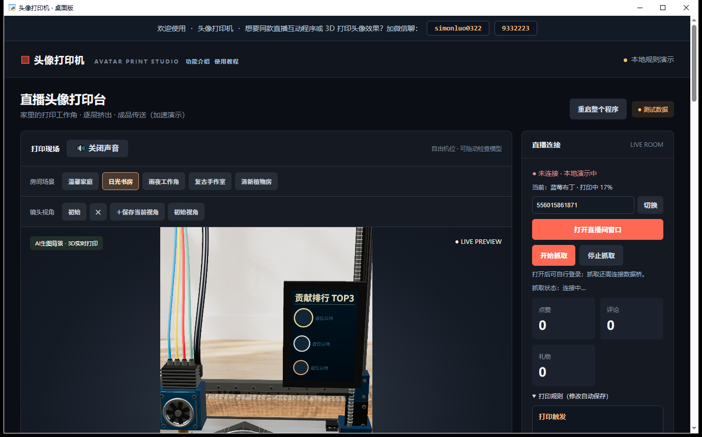
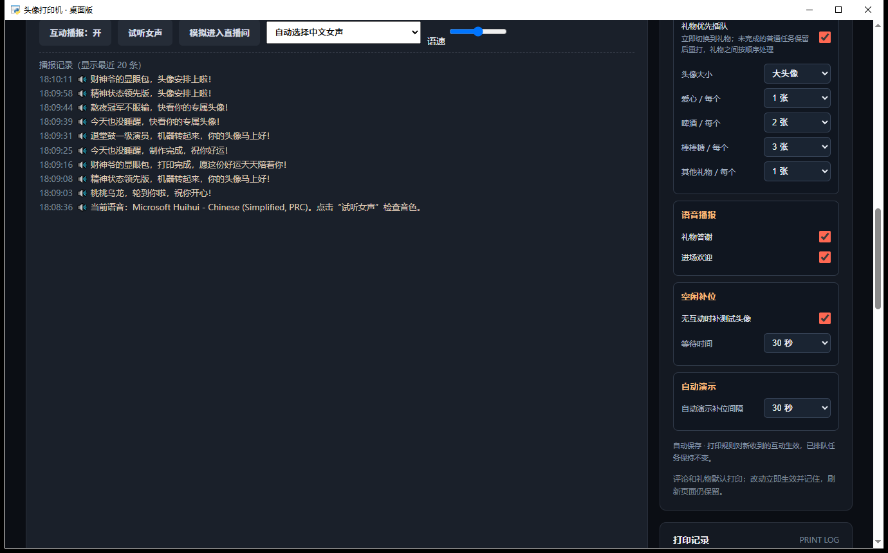

# 头像打印机（3D Printer Live）· Windows 免依赖一键版

抖音直播互动「3D 打印头像」演示程序：抓取直播间互动（评论 / 点赞 / 关注 / 礼物），在 3D 场景里逐层"打印"观众头像，并显示「本场贡献榜」TOP3（金 / 银 / 铜边框）。排行榜有**两种显示方式**：3D 场景里立在打印机右侧的排行牌，和叠在画面上的**屏幕角标**（小窗 / OBS 采集也看得见），工具栏一键切换。

本仓库是在原作者开源项目基础上的**本机免依赖改造版**：自带 Python / Node 运行环境下载逻辑，双击即用，不需要你电脑里装过 Python、Node 或任何依赖。

- 上游项目：<https://github.com/rhfbgfgfdg999999/3d-printer-live>（MIT，作者「志哥AI」）
- 本仓库：<https://github.com/simonluo0322/simon-avatar-printer-portable>

## 界面预览

下面是本版**实际运行**的窗口截图（Windows 桌面版，1380×860）：

| 主界面：3D 打印现场 + 右侧「贡献排行 TOP3」 | 互动播报记录（100 条 + 时间戳） |
| --- | --- |
|  |  |

上游项目的原始界面截图保留在 `app/docs/screenshots/01~05`，可用于对比。


---

## 一、朋友怎么装（三步）

1. 打开本仓库页面，点绿色 **Code → Download ZIP**，解压到任意文件夹（路径别带特殊符号）。
2. 双击 **`一键安装并启动.bat`**。
   - 第一次会自动下载约 160MB 的运行环境（Python 3.13 + Node 22），**只需下一次**；
   - 下载完成后自动解压并启动程序，之后每次双击这个文件就是秒开。
3. 看到「头像打印机 · 桌面版」窗口就成功了。若报错，双击 `一键启动-诊断模式.bat` 看具体原因。

> 需要 Windows 10/11 且系统里有 **WebView2 运行时**（Win11 自带；Win10 若提示缺失，装一下微软官方的 "Microsoft Edge WebView2 Runtime" 即可，免费）。
> 首次运行会请求防火墙/权限，都点允许；程序只在本机跑，不上传任何数据。

## 二、让豆包帮你一键装（推荐给不太会电脑的朋友）

把下面这句话直接发给豆包（或任何能操作电脑的 AI 助手）：

```
帮我安装并运行这个 GitHub 项目：https://github.com/simonluo0322/simon-avatar-printer-portable
下载 ZIP 解压到 C:\头像打印机，然后双击运行 一键安装并启动.bat，装好后告诉我访问地址。
```

## 三、目录结构

```
simon-avatar-printer-portable/
├─ 一键安装并启动.bat      ← 首次安装 + 启动（推荐先双击这个）
├─ 一键启动.bat            ← 已装好后日常启动（无控制台黑框）
├─ 一键启动-诊断模式.bat   ← 出问题时用，会保留报错窗口
├─ 一键启动-网页版.bat     ← 不想开独立窗口，用浏览器打开
├─ start-app.py            ← 启动器（负责拉起本地服务 + 独立窗口 + 退出清理）
├─ start-browser.py        ← 网页版启动器
├─ printer.ico             ← 桌面快捷方式图标
├─ 使用说明.md             ← 完整使用手册（含各功能开关、计分规则）
├─ app/                    ← 程序本体
│   ├─ index.html          ← 主界面（3D 场景 + 排行榜 + 控制面板）
│   ├─ index-en.html       ← 英文界面
│   ├─ launch.py           ← 本地 HTTP 服务（默认 127.0.0.1:8081）
│   ├─ douyin-bridge.mjs   ← 直播数据桥（CDP 抓取直播间互动）
│   ├─ live-view.html      ← 直播小窗 / OBS 采集用的镜像画面
│   ├─ scene_relay.py      ← 多窗口消息中继
│   └─ assets/             ← three.js、音频、图标等静态资源
└─ runtime/                ← 首次安装时自动下载（不入仓库）
```

## 四、常用地址与端口

| 用途 | 地址 / 端口 |
| --- | --- |
| 主界面 | `http://127.0.0.1:8081/` |
| 直播数据桥 | `ws://127.0.0.1:8765` |
| 直播间窗口调试端口 | `9224`（桌面版）/ `9223`（网页版） |

> 8080 被占用时会自动顺延到 8081；程序退出时会清理自己拉起的 node / chrome / msedge 子进程。

## 五、排行榜计分规则（本版自定义）

| 行为 | 计分 | 打印 |
| --- | --- | --- |
| 点赞 | 1 分/个（每人上限 50 分） | 每人上限 50 张，排队永远排最后 |
| 评论 | 2 分/条（不封顶） | 每条 1 张，排在点赞前面 |
| 关注 | 5 分/次（不封顶） | 1 张 |
| 进场 | 0 分 | 不打印 |
| 爱心 / 人气票 | 10 分/个 | 按数量 |
| 啤酒 | 30 分/个 | 按数量 |
| 棒棒糖 | 50 分/个 | 按数量 |
| 大礼物（嘉年华 / 跑车 / 火箭 / 抖音1号等） | 100 分/个 | 按数量，可抢占 |
| 其他未登记礼物 | 5 分/个（兜底） | 按数量 |

- 付费礼物**可以抢占**正在打印的免费互动任务；礼物之间按价格排队，越贵的越靠前；
- 免费互动的排队顺序：**关注 → 评论 → 进场 → 点赞**（点赞永远最后）；
- 点赞每人最多计 50 分、最多打印 50 张，超过后不再加分也不再打印；点赞排队永远排在最后；
- 贡献榜只显示 TOP3（金 / 银 / 铜边框），两行版式：`TOP1 | 贡献值` + `@昵称`，头像带金/银/铜环；
- 排行榜**重启即清零**，只在本次运行内累加。

### 排行榜的两种显示

| 方式 | 位置 | 适合 |
| --- | --- | --- |
| 3D 排行牌 | 立在打印机右侧的实体牌（金属滑轨下沿对齐） | 主窗口、3D 近景/全景镜头里都在 |
| 屏幕角标 | 画面右中位置的三行大字幕（`live-view.html` 渲染） | 直播伴侣采集小窗、OBS，画面缩放后依然清晰 |

工具栏「排行榜角标」按钮控制角标开关；两种可以同时开，也可以只留一种。

## 六、本版相对上游的主要改动

1. **免依赖**：自带运行时下载与路径注入，不依赖系统 Python / Node。
2. **一键启动**：桌面快捷方式 + 无控制台黑框 + 退出精确清理子进程（node / chrome / msedge）。
3. **状态牌**（画面上那张"当前正在打印谁"的卡片）：改成 3D 可渲染流，直播小窗和 OBS 都能看到；宽度贴合文字、左右边距一致。
4. **贡献排行榜（两种显示）**：
   - 3D 排行牌：立在打印机右侧的竖版窄牌，TOP3 金/银/铜环，头像走本地代理避免跨域污染画布；
   - 屏幕角标：`live-view.html` 里的「本场贡献榜」两行字幕（`TOP1 | 贡献值` / `@昵称`），按窗口像素比例渲染，缩到小窗也清晰；
   - 昵称归一化合并同名，重启即清零。
5. **计分体系**：从"打印次数"改为"贡献值积分"，礼物按名称精确匹配 + 兜底低分，防白嫖与防刷屏。
6. **礼物采集（两层去重）**：补齐协议级 `WebcastGiftMessage` 解析；协议连发两帧时按「昵称+礼物名+重复次数 + 8 秒窗口」去重；协议帧活着时不再听弹幕文本，避免同一条送礼被反复计分。
7. **小窗/多窗口**：独立画面窗口支持置顶、隐藏后再显示不丢帧；端口探测不再写死。
8. **互动播报**：最近 100 条滚动记录 + 时间戳，替代原来"一条顶一条"；欢迎 / 感谢 / 打印三类话术各扩到 20–30 条随机不连重。
9. **播报语音**：用本机系统语音（Windows SAPI 中文女声），事件一到就出声；语音、语速、开关都在播报区下拉里调。
10. **打印床铭牌**：床头黑牌改为 `9332223` / `AI智能头像打印机`，居中、面积收窄。
11. **防卡顿**：给 WebView2 补了反节流参数，窗口被别的窗口遮挡时不掉帧（最小化仍会掉帧，属内核限制，保持窗口不最小化即可）。

## 七、许可证

上游代码为 MIT 协议（见 `app/LICENSE`，作者「志哥AI」）。本仓库的本地化改造部分同样以 MIT 发布，请保留原作者署名。程序内置的顶部推广文字（原作者联系方式）属于上游内容，你可以按自己的直播间需要替换成自己的信息。

---

遇到问题：先跑 `一键启动-诊断模式.bat`，把控制台红字发出来即可定位。
